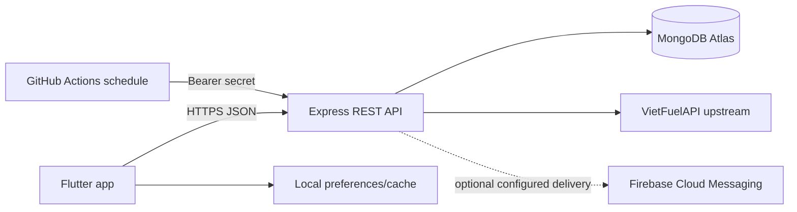

# Architecture

The repository is a monorepo with a Flutter client and a TypeScript modular monolith. The client calls the versioned REST API; only the backend connects to MongoDB. The UI calculator runs locally. A GitHub Actions schedule calls the protected sync endpoint.

Backend modules currently cover price/fuel reads, history queries, analytics summaries, protected synchronization, credential-protected device preferences/token registration and an optional Firebase Admin outbox sender. Schemas use unique keys for fuels, latest price tuples, installations, notification event keys and price record keys. Controllers are colocated with the Express application while normalization and synchronization are isolated in `sync.ts`; this is a small foundation and is not yet the full router/controller/service/repository layering specified in the project brief.

The mobile app has four persistent bottom-navigation branches, server-backed price/history views and a local cost calculator. SharedPreferences currently provides a small response cache and local settings; Drift/SQLite and client device push registration are not yet implemented.

## Data integrity

The app must not invent prices. API calls return an unavailable/empty state until real upstream data is validated and stored. Periods use observed adjustment records; the history response declares coverage incomplete. No daily interpolation is performed. The upstream URL and payload are still unverified in this environment, so the sync adapter is fail-closed and requires an upstream contract check before production use.
